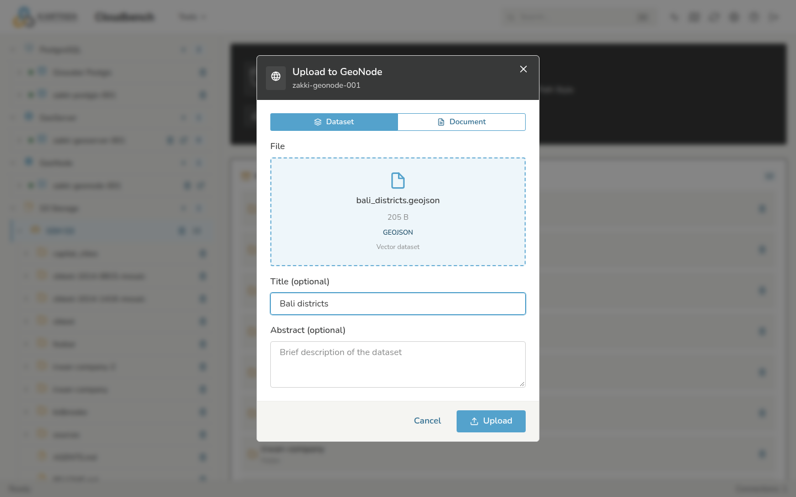

# GeoNode Uploads

A **GeoNode** connection lets you upload a dataset to a GeoNode site and set
its title and abstract in the same step. For adding the connection, see
[Connections](../guide/connections.md).

## Uploading a dataset

1. Select a **GeoNode** connection and click **Upload**.
2. Choose the file (a vector or raster GeoNode accepts; a shapefile goes as its
   components or a single-shapefile ZIP).
3. Set the **title** and, optionally, an **abstract**.
4. Upload. CloudBench sends the file to GeoNode and reports when the import
   finishes.

## Titles and abstracts

GeoNode imports a dataset under a name derived from the file, and does **not**
apply a title or abstract sent with the upload itself. So CloudBench sets them
in a second step: once the import finishes, it updates the new dataset with the
title and abstract you entered.

Because that happens just after the import completes, the title may appear a
moment later than the dataset:

- If the dataset shows the filename briefly, give it a few seconds and refresh.
- If the title never updates, the account may lack permission to edit the
  dataset, or the import may not have finished — check the dataset in GeoNode.

## Permissions

Uploads and the title update use the connected GeoNode account's permissions.
If a dataset uploads but can't be edited, that account can't modify it in
GeoNode either.

## Troubleshooting

- **Upload rejected for size.** GeoNode enforces its own upload size limit,
  separate from CloudBench's.
- **Dataset appears but is empty or broken.** Check the file's coordinate
  system and that the format is one GeoNode supports.

More general symptoms are in [Troubleshooting](../help.md).
