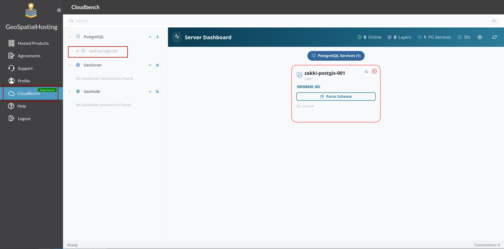
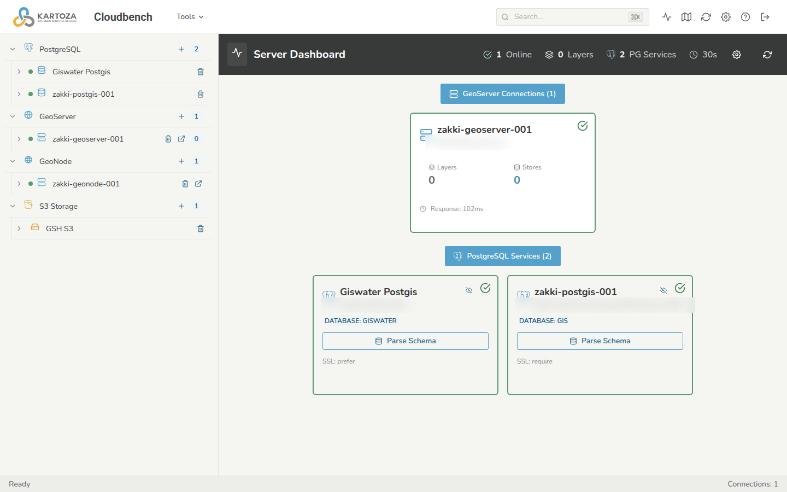

# CloudBench

## What is CloudBench?

**CloudBench** is a geospatial data management and processing platform available through your GeoSpatialHosting account. It provides a central interface for working with hosted GeoServer, GeoNode, and PostgreSQL/PostGIS instances, as well as external S3-compatible storage services.

Instead of logging in to each service separately, CloudBench brings several common geospatial workflows together in one place. Users can browse their data, manage resources, upload datasets, run conversions, and preview supported layers directly through a web interface.

CloudBench also supports converting geospatial datasets into cloud-native formats, making it easier to store, access, and visualise large datasets without requiring a separate map server for every layer.

 

  

 

## Key Capabilities

- **GeoServer Management**

    Browse workspaces, data stores, coverage stores, layers, styles, and layer groups. Edit layer metadata, including titles, abstracts, keywords, and attribution.

     

- **Interactive Map Preview**

    Preview supported layers on an interactive map using WMS and WMTS services before using them elsewhere.

     

- **GeoWebCache Management**

    Seed, reseed, and truncate cached tiles for layers, with progress displayed during the operation.

     

- **Server Synchronisation**

    Replicate GeoServer resources, including workspaces, stores, layers, and styles, between different GeoServer instances.

     

- **PostgreSQL & PostGIS Integration**

    Connect to hosted databases, browse schemas and tables, and execute SQL queries.

     

- **Geospatial File Uploads**

    Upload supported geospatial files to connected services and storage locations, with upload progress tracking.

     

- **S3 Storage Management**

    Browse and manage datasets stored in S3-compatible object storage, including cloud-native geospatial formats.

     

- **Cloud-Native Data Conversion**

    Convert supported raster, vector, and point cloud datasets into formats such as COG, PMTiles, GeoParquet, and COPC.

     

- **GeoNode Integration**

    Upload supported datasets to connected GeoNode sites and provide dataset titles and abstracts.

     

- **QGIS Server & 3D Visualisation**

    Manage and preview supported QGIS Server projects and explore compatible datasets using an interactive 3D globe.

 

## How CloudBench Works

CloudBench connects to your existing geospatial services through saved connections.

When accessed through GeoSpatialHosting, CloudBench automatically uses your account to identify the hosted instances available to you. Connections to these instances are generally configured already, so you can start browsing your resources without setting them up manually.

You can also add connections to other supported services and storage locations.

Once connected, you can browse your data, upload files, perform supported operations, and preview the resulting layers directly through the CloudBench interface.

 

  

 

## Supported Services & Formats

CloudBench works with several geospatial services and storage solutions.

<table class="my-table-style">
  <thead>
    <tr>
      <th>Format</th>
      <th>Description</th>
    </tr>
  </thead>
  <tbody>
    <tr>
      <td>GeoServer</td>
      <td>Manage workspaces, data stores, layers, styles, and cached tiles.</td>
    </tr>
    <tr>
      <td>PostGIS</td>
      <td>Browse spatial databases, schemas, and tables, and execute SQL queries.</td>
    </tr>
    <tr>
      <td>GeoNode</td>
      <td>Upload and manage geospatial datasets on a connected GeoNode site.</td>
    </tr>
    <tr>
      <td>S3 Storage</td>
      <td>Store, browse, and convert geospatial datasets in object storage.</td>
    </tr>
  </tbody>
</table>

 

CloudBench also supports several cloud-native output formats:

- **COGs** - For raster datasets such as imagery and elevation models.
- **PMTiles** - For serving vector tiles from a single file.
- **GeoParquet** - For storing and querying vector features and their attributes.
- **COPCs** - For streaming and visualising LiDAR point clouds.

 

## Typical Workflows

CloudBench can support a range of geospatial data workflows, including:

- Browsing and managing resources across connected GeoServer instances.
- Previewing published layers before using them in other applications.
- Managing cached map tiles through GeoWebCache.
- Synchronising resources between GeoServer instances.
- Browsing and querying PostgreSQL/PostGIS databases.
- Uploading datasets to GeoNode.
- Uploading geospatial files to S3-compatible storage.
- Converting raster, vector, and point cloud datasets into cloud-native formats.
- Previewing converted datasets on a map, in a table, or in a 3D viewer.

 

CloudBench is particularly useful for organisations that work with multiple geospatial services and want a central place to manage their data and common GIS workflows.

 

## Getting Started & Resources

CloudBench is available directly through your GeoSpatialHosting account. You do not need to create a separate CloudBench instance or register for another account.

If you are accessing CloudBench for the first time, start with the First Log In guide.

 

Use the guides and resources below to get started:

  

    

      🔐 <a href="./guide/first_login/">First Log In</a>
    

    

      Access CloudBench through your GSH account and familiarise yourself with the initial setup.
    

  

  

    

      🗺️ <a href="./guide/quickstart/">Quickstart: 5-Minute Tutorial</a>
    

    

      Connect to a data source, upload a dataset, and explore CloudBench's geospatial data workflows.
    

  

  

    

      🎫 <a href="https://geospatialhosting.com/#/dashboard/support">Create a Support Ticket</a>
    

    

      Create a support ticket from the GeoSpatialHosting dashboard.
    

  

 
